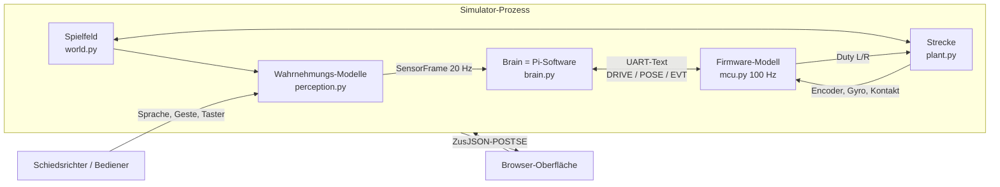

# Architektur

Der Simulator folgt der in **MS2** gewählten Variante **V2 «Verteilte Architektur»** und der Referenzarchitektur der
Blockschaltbilder (Ebene 1 Funktionen, Ebene 2 Software/Elektronik, Zustandsdiagramm).

## Aufteilung Pi 5 ↔ Mikrocontroller

| Teil | Läuft (später) auf | Im Simulator | Inhalt |
|---|---|---|---|
| **Wahrnehmung** (Sprache, Gesten, Knochen) | Raspberry Pi 5 | `perception.py` (Modelle) | Schlüsselworterkennung, Handpose, Objektdetektor, Distanzsensor, Berührung |
| **Befehls-Arbitration** | Raspberry Pi 5 | `brain.py` | Konfidenzschwellen, Mehrheitsfilter für Gesten, Sperrzeit, Taster-Fallback |
| **Zustandsautomat / Verhalten** | Raspberry Pi 5 | `brain.py` | Zustände nach `Zustandsdiagramm_PREN1`, Suchstrategie, Quittierung |
| **Echtzeit-Regelung, Odometrie** | Mikrocontroller | `mcu.py` (Firmware-Modell, 100 Hz) | PI-Radregler, Encoder + Gyro, Rampen |
| **Not-Aus, Watchdog** | Mikrocontroller | `mcu.py` | Hardware-Not-Aus wirkt ohne Rechner; Watchdog stoppt bei stillem Rechner |
| **Haltung, Ausdruck** (SITZ/PLATZ/AUF, Schwanz, Ohren) | Mikrocontroller | `mcu.py` + `plant.py` | `POSE …`, `SHOW …` |
| **Spielfeld/Digital Twin** | nur Simulator | `world.py`, `plant.py`, `engine.py` | wahre Pose, Knochen, Schiedsrichter, Akku |

Warum so? MS2: *«Echtzeit und Not-Aus unabhängig vom Rechner; der Mikrocontroller hält den Roboter auch bei einem Rechner-Absturz sicher an.»*
Genau das wird getestet (`tests/test_simulator.py`: Watchdog, Hardware-Not-Aus bei getrennter Verbindung; Szenarien 03 und 07).

## Datenfluss

* **Brain kennt nur** den `SensorFrame` und die Telegramme des Mikrocontrollers – niemals die wahre Pose. Es muss mit Odometrie-Drift,
  Rauschen und Fehlerkennungen zurechtkommen (die Rückkehr ins Startfeld nutzt kein Klebeband, Anf. 3.4).
* **Zeitraster:** Physik/Firmware 100 Hz (`sim.dt = 0.01`), Wahrnehmung + Brain 20 Hz, Telemetrie MCU→Pi 20 Hz, Oberfläche 20 Hz.
* **Determinismus:** alles hängt am Seed (`--seed`), Szenarien sind damit reproduzierbar.

## Zustandsautomat (Brain)

Zustände aus dem Zustandsdiagramm (`brain.TRANSITIONS`, in der Oberfläche live dargestellt):
`INIT → BEREIT ⇄ PLATZ`, `BEREIT → HIER → BEREIT`, `BEREIT → DREHEN → SUCHEN → ANFAHREN → FUND_MELDEN → RUECKKEHR → BEREIT`,
`BEREIT → KUNSTSTUECK → BEREIT`, `NOT_AUS` aus jedem Zustand.

Bewusste Abweichungen/Präzisierungen gegenüber dem Diagramm (im Team bestätigen):

1. **Timeout (2 min)** führt nicht direkt nach BEREIT, sondern über **RUECKKEHR** (der Roboter muss auch bei Abbruch ins Startfeld und sitzen).
2. **SITZ/AUF** sind Haltungswechsel *innerhalb* von BEREIT (nur PLATZ hat einen eigenen Zustand wie im Diagramm); der Roboter fährt nur im Stand.
3. **Reset nach Not-Aus** führt nach BEREIT (im Diagramm nach PLATZ).
4. Zusätzlicher Fehlerpfad: **Verbindung zum Mikrocontroller verloren → NOT_AUS (Fehler)**, automatische Erholung bei Rückkehr der Verbindung.

## Suchstrategie

1. **DREHEN**: Ausrichten auf die Achse des Suchbereichs (= Startrichtung + 180°, aus der Odometrie – der Roboter kennt das Spielfeld nicht).
2. **SUCHEN**: Abfahren der Achse in Wegpunkten (1, 2, 3, 4, 4.65 m), dann zurück (Ping-Pong); Kamera mit 66° überdeckt das 30°-Segment.
   Erkennung gilt nach **3 Treffern in 1.2 s**. Detektionen, deren geschätzte Position **ausserhalb des Suchbereichs** liegt, werden verworfen (FAQ 6).
3. **ANFAHREN**: Peilregelung auf die Bildposition, Distanz aus Bild/Distanzsensor; unter 0.55 m (Knochen unter dem Bildfeld) blind geradeaus.
4. **Berührung**: Fühler an der Nase (MCU) **oder** kamerabasierte Erkennung (TF22: Normalfall Kamera, Fallback Taster) → sofortige Quittierung am Fundort.
5. **RUECKKEHR**: Odometrie zum Startpunkt, Ausrichten, kurz beruhigen, **SITZ**.

## Modelle und ihre Grenzen

| Modell | Datei | Annahmen (siehe [ANNAHMEN.md](ANNAHMEN.md)) |
|---|---|---|
| Antrieb 1. Ordnung, Encoder-Quantisierung, Radius-/Spur-Toleranz, Gyro-Bias | `plant.py` | Werte geschätzt |
| Haltungswechsel als lineare Rampe | `plant.py` | Dauern geschätzt (MS3: Hebel/Drehmoment auslegen) |
| Sprache: Erkennungsrate = Sigmoid(SNR), Latenz, Verwechslungen, Fehlauslösungen | `perception.py` | Platzhalter bis Messung mit Mikrofon |
| Gesten: Erkennungsrate je Bild nach Distanz/Licht, Mehrheitsfilter (Brain-Code!) | `perception.py` + `brain.vote_gesture` | Platzhalter |
| Knochen: Detektionsrate nach Distanz/Licht/Bodenähnlichkeit | `perception.py` | Platzhalter, Reichweite 6 m |
| Energie: Leistung aus Grundlast + Motoren + Servos | `plant.py` | 38.4 Wh, ca. 14 W Mittel |

## Wechsel auf die echte Hardware

* `link.SimLink` → `link.SerialLink` (UART des Pi, gleiches Textprotokoll, braucht `pyserial`); die Firmware auf dem ESP32 setzt `protocol.py` um.
* `perception.SimSensors` → eigene Klasse mit echtem Mikrofon (z. B. Vosk), Kamera (Handpose, Objektdetektor), Distanzsensor, die einen `SensorFrame` liefert (`hal.py`).
* `brain.py` bleibt unverändert; der Simulator läuft weiter als Regressionstest und zum Entwickeln ohne Roboter.
